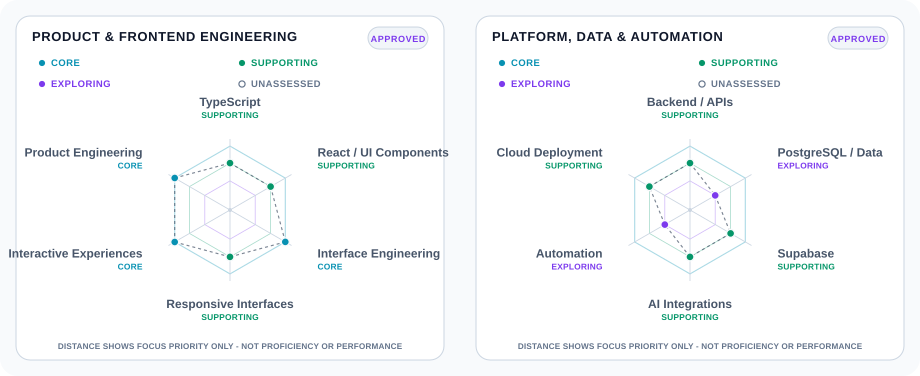
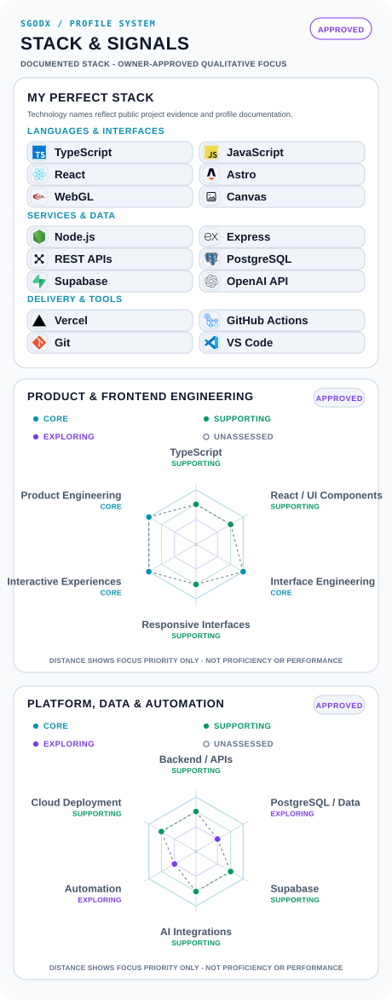
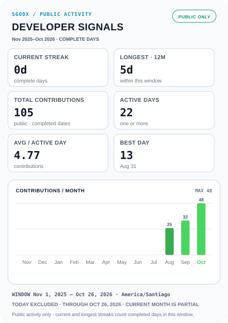

<!-- ===== THEME-AWARE HERO ===== -->
<picture>
  <source
    media="(prefers-color-scheme: dark)"
    srcset="https://raw.githubusercontent.com/dpsychoo/dpsychoo/main/dark.svg">
  <source
    media="(prefers-color-scheme: light)"
    srcset="https://raw.githubusercontent.com/dpsychoo/dpsychoo/main/light.svg">
  
</picture>

<!-- ===== PROFESSIONAL POSITIONING ===== -->

<strong>Full-Stack Development &middot; AI Integrations &middot; SaaS Solutions</strong>

Building digital products and exploring custom software, SaaS, system integrations and workflow automation for technology companies, mining and industrial contractors, startups, and businesses across industries.

Portfolio links document existing work; industry references describe future opportunities.

  <picture>
    <source media="(max-width: 767px) and (prefers-color-scheme: dark)" srcset="./profile/radar-pair-narrow-dark.svg">
    <source media="(max-width: 767px)" srcset="./profile/radar-pair-narrow-light.svg">
    <source media="(min-width: 768px) and (prefers-color-scheme: dark)" srcset="./profile/radar-pair-dark.svg">
    <source media="(min-width: 768px)" srcset="./profile/radar-pair-light.svg">
    
  </picture>

<!-- ===== CONTRIBUTION SNAKE ===== -->
<picture>
  <source
    media="(prefers-color-scheme: dark)"
    srcset="https://raw.githubusercontent.com/dpsychoo/dpsychoo/output/snake-dark.svg?v=2">
  <source
    media="(prefers-color-scheme: light)"
    srcset="https://raw.githubusercontent.com/dpsychoo/dpsychoo/output/snake-light.svg?v=2">
  
</picture>
<!-- ===== PROJECTS ===== -->
<picture>
  <source
    media="(prefers-color-scheme: dark)"
    srcset="https://raw.githubusercontent.com/dpsychoo/dpsychoo/projects/projects.svg">
  <source
    media="(prefers-color-scheme: light)"
    srcset="https://raw.githubusercontent.com/dpsychoo/dpsychoo/projects/projects-light.svg">
  
</picture>

  <strong>SGX VI</strong> ·
  <a href="https://create.sgodx.com/">LIVE APP</a> |
  <a href="https://github.com/dpsychoo/gta-vi-generator-showcase">CASE STUDY</a> |
  <a href="https://dpsychoo.github.io/gta-vi-generator-showcase/">ARCHITECTURE</a> 
  <a href="https://github.com/dpsychoo/Itachi_SGODX">SGODX — UCHIHA ITACHI · Source</a>

<!-- ===== GITHUB STATS ===== -->

  <picture>
    <source
      media="(prefers-color-scheme: dark)"
      srcset="./profile/stats-dark.svg">
    <source
      media="(prefers-color-scheme: light)"
      srcset="./profile/stats-light.svg">
    
  </picture>
  <picture>
    <source
      media="(prefers-color-scheme: dark)"
      srcset="./profile/languages-dark.svg">
    <source
      media="(prefers-color-scheme: light)"
      srcset="./profile/languages-light.svg">
    
  </picture>

<!-- ===== STACK & SIGNALS ===== -->
<h2 align="center">STACK &amp; SIGNALS</h2>

MY PERFECT STACK · 16 DOCUMENTED TECHNOLOGIES · THREE CATEGORIES

  <picture>
    <source media="(max-width: 767px) and (prefers-color-scheme: dark)" srcset="./profile/stack-signals-narrow-dark.svg">
    <source media="(max-width: 767px)" srcset="./profile/stack-signals-narrow-light.svg">
    <source media="(min-width: 768px) and (prefers-color-scheme: dark)" srcset="./profile/stack-signals-dark.svg">
    <source media="(min-width: 768px)" srcset="./profile/stack-signals-light.svg">
    
  </picture>

  <picture>
    <source media="(prefers-color-scheme: dark)" srcset="./profile/developer-stats-dark.svg">
    <source media="(prefers-color-scheme: light)" srcset="./profile/developer-stats-light.svg">
    
  </picture>

<strong>Focus radar:</strong> CORE marks a primary current focus; SUPPORTING marks complementary documented work; EXPLORING marks a future or developing area; UNASSESSED marks a dimension without an owner-approved focus category. The classifications are owner-approved descriptions of professional focus, informed by public project documentation where available. Radial distance shows categorical focus priority only, never proficiency, performance, seniority or certification. See <a href="docs/radar-evidence.md">dimension-by-dimension evidence and limits</a>.

<strong>Contribution readout:</strong> This generated image is a static public-contribution snapshot, not a live feed. It covers the twelve-calendar-month window through the latest complete date in America/Santiago. The in-progress current date is excluded. An active day has at least one contribution; average is total contributions divided by active days; streaks count consecutive active dates within the same window; monthly bars use those same dates.

<!-- ===== SOCIAL BADGES ===== -->

   
  &#160;&#160;
  &#160;&#160;
  &#160;&#160;
  

